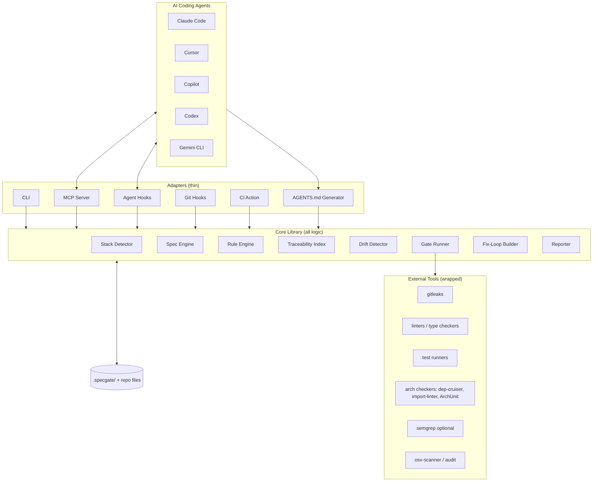
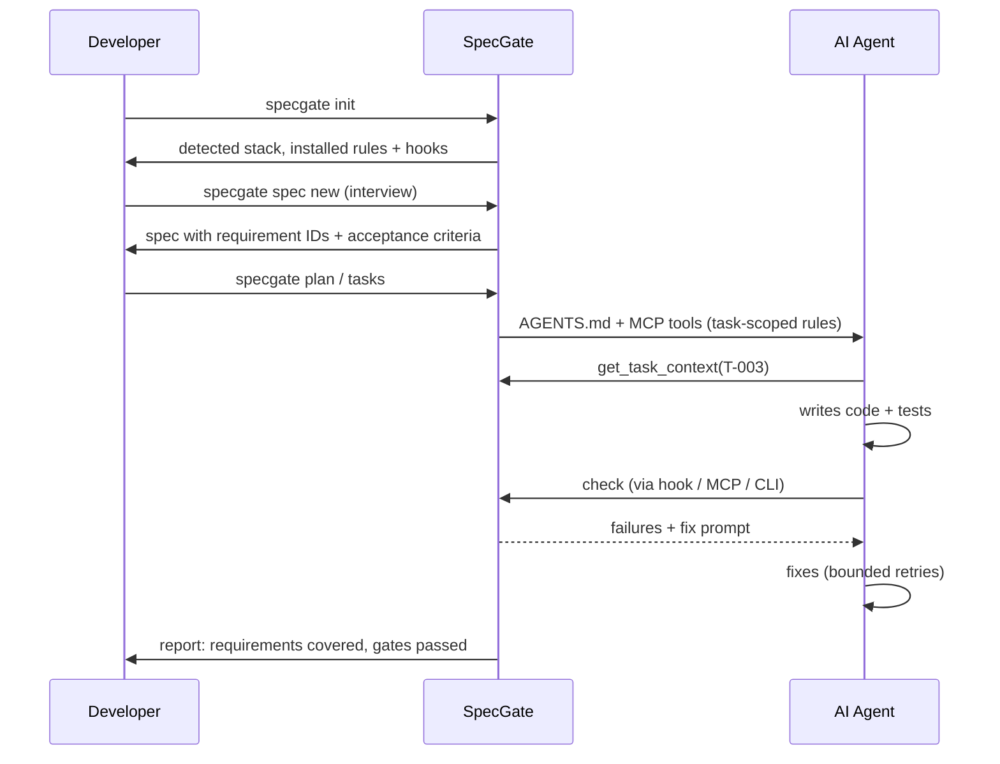

# SpecGate (working name)

> A CLI-first, local-first tool that keeps AI coding agents honest: **spec before code, rules while coding, gates before merge.**

**Status:** Architecture / pre-development
**Document purpose:** Single source of truth for design. Humans and AI coding agents should read this fully before writing code. If code and this document disagree, fix one of them in the same change.

---

## Table of Contents

1. [Problem & Vision](#1-problem--vision)
2. [Goals, Non-Goals, Principles](#2-goals-non-goals-principles)
3. [Key Decisions (ADR summary)](#3-key-decisions-adr-summary)
4. [System Overview](#4-system-overview)
5. [Core Modules](#5-core-modules)
6. [On-Disk Layout (in the user's repo)](#6-on-disk-layout-in-the-users-repo)
7. [Data Formats & Schemas](#7-data-formats--schemas)
8. [CLI Reference](#8-cli-reference)
9. [Agent Integration Layer](#9-agent-integration-layer)
10. [Gate Runner](#10-gate-runner)
11. [Rule Packs](#11-rule-packs)
12. [Traceability & Drift Detection](#12-traceability--drift-detection)
13. [Fix Loop](#13-fix-loop)
14. [Brownfield Support](#14-brownfield-support)
15. [UX Principles for Mass Adoption](#15-ux-principles-for-mass-adoption)
16. [Security & Privacy](#16-security--privacy)
17. [Tech Stack](#17-tech-stack)
18. [Repository Layout (this project)](#18-repository-layout-this-project)
19. [Testing Strategy](#19-testing-strategy)
20. [Milestones & Acceptance Criteria](#20-milestones--acceptance-criteria)
21. [Risks & Resolved Decisions](#21-risks--resolved-decisions)
22. [Instructions for AI Agents Working on This Repo](#22-instructions-for-ai-agents-working-on-this-repo)
23. [Reference Projects](#23-reference-projects)
24. [Distribution & Installation](#24-distribution--installation)
25. [Product Explainer, FAQ & Interview Q&A](#25-product-explainer-faq--interview-qa)

---

## 1. Problem & Vision

### Problem
When developers use AI coding agents (Claude Code, Cursor, Copilot, Codex, Gemini CLI) on medium-to-large projects:

1. **Context & prompt drift**: the agent forgets requirements and produces inconsistent code across files and sessions.
2. **Architectural & security violations**: functional code that breaks layering, bypasses patterns, or leaks secrets.
3. **Unverifiable "done"**: the agent claims completion with no proof tied to requirements.

### Vision
SpecGate is a **closed-loop enforcement layer** around any AI coding agent:

```
Define spec  ->  Inject only relevant rules  ->  Agent codes  ->  Gates verify  ->  Failures fed back  ->  Done = provable
```

The differentiator is **verification and feedback**, not spec generation. Spec templates and rule injection are commodity; proving code matches spec and rules, then driving the agent to fix violations, is the product.

---

## 2. Goals, Non-Goals, Principles

### Goals
- G1. Zero-config start: one command detects stack, installs sane defaults.
- G2. Works with any agent via native surfaces (AGENTS.md, MCP, hooks, git hooks, CI).
- G3. Every requirement is traceable to tasks, tests, and commits.
- G4. Gates produce human-readable, actionable failures and machine-readable output.
- G5. Works on brownfield repos, not only greenfield.
- G6. Local-first: no account, no network required for core features, no telemetry by default.

### Non-Goals (v1)
- Not an AI agent or code generator itself.
- Not a hosted SaaS or dashboard service.
- Not a replacement for code review.
- Not auto-converting natural-language rules into static analysis rules (see 11).
- Not intercepting/proxying agent prompts (fragile; see ADR-003).

### Principles
1. **Native surfaces over interception.** Integrate where agents already look.
2. **One core, thin adapters.** All logic lives in `core`; CLI, MCP, hooks are wrappers.
3. **Deterministic gates, advisory AI.** Pass/fail is decided by tools, never by an LLM.
4. **Selective context.** Inject the minimum rules relevant to the current task.
5. **Graduated strictness.** Advisory -> standard -> strict. Never strict by default.
6. **Everything is files.** State lives in plain, diffable, git-tracked files.
7. **Explain every failure** with the cause, location, and a suggested fix.

---

## 3. Key Decisions (ADR summary)

| ID | Decision | Rationale | Revisit if |
|----|----------|-----------|------------|
| ADR-001 | Implement in **TypeScript on Node 20+** | `npx` zero-install distribution, official MCP SDK, easy to ship to JS/TS-heavy agent users | Single-binary distribution becomes critical (consider Go/Rust rewrite of gate runner) |
| ADR-002 | **Core library + adapters** architecture | Reuse logic across CLI, MCP, hooks, CI | n/a |
| ADR-003 | **No prompt interception**; integrate via AGENTS.md, MCP, hooks, git hooks, CI | Agent tools change often; native surfaces are stable | An agent exposes a stable prompt middleware API |
| ADR-004 | **Wrap external tools** (gitleaks, linters, test runners) through a uniform `Gate` interface; do not reimplement them | Leverage mature tools | Tool unavailable on a platform |
| ADR-005 | **Executable rule packs** per stack for enforcement; prose rules for guidance only | NL rules cannot be reliably compiled to checks | Reliable NL-to-check compilation emerges |
| ADR-006 | **Spec format = Markdown + YAML frontmatter + stable IDs** | Human-friendly, diffable, parseable, traceable | n/a |
| ADR-007 | **File-based state** in `.specgate/`, no database | Git-native, transparent, no infra | Scale needs indexing (add optional SQLite cache, never as source of truth) |
| ADR-008 | **Strictness levels** (advisory/standard/strict) | Adoption; strict-by-default tools get removed | n/a |
| ADR-009 | Project license **Apache-2.0**. First-party rule packs are **written originally**; third-party rule text is never copied, only referenced or fetched at install time with its license recorded | Patent grant, enterprise-friendly; ideas are free to reuse, text is not | A dependency or pack requires a different license |
| ADR-010 | Interview wizard uses **templated questions standalone**; the host agent does the language work via MCP/slash commands. Bring-your-own-key LLM mode is post-v1 | No keys, no accounts, no cost to the user | Standalone UX tests poorly |
| ADR-011 | Spec Kit / OpenSpec compatibility is **import-only** (`specgate import`) | Interop without maintaining two-way sync | Users demand export |
| ADR-012 | Git hooks via `core.hooksPath` -> `.specgate/hooks/` using tiny **Node shims**; detect and integrate with husky / pre-commit / lefthook instead of replacing them; shim **warns and skips** if the tool is missing | Works on Windows (Git for Windows runs hooks through its bundled shell), and teammates without the tool are not blocked (CI is the backstop) | Hook failures show up in pilot feedback |
| ADR-013 | Config tamper protection: locally **flag for human review**; at `strict` + CI **block** changes to config/baseline unless approved via CODEOWNERS or a label. Disabling a gate requires a `reason:` field | Blocking locally annoys legitimate edits; CI is where it matters | n/a |
| ADR-014 | **Distribution:** npm (primary), standalone binaries + Homebrew/Scoop, GitHub Action, Claude Code plugin + MCP listing. End users never clone this repo (see 24) | Meet users where they already install things | n/a |
| ADR-015 | **Managed tool binaries:** `specgate doctor --install` downloads pinned, checksum-verified tools (e.g. gitleaks) into `~/.specgate/bin` after explicit consent | Removes the biggest "it doesn't work" cause: missing external tools | Security review objects |

---

## 4. System Overview



### Lifecycle



---

## 5. Core Modules

All modules live in `packages/core`. Each exposes a pure-ish TypeScript API; adapters only parse input and render output.

### 5.1 Stack Detector
- **Input:** repo root path.
- **Output:** `StackProfile` (languages, frameworks, package managers, test runners, linters, existing architecture hints, CI provider).
- **Method:** file-signature heuristics (`package.json`, `pyproject.toml`, `pom.xml`, `go.mod`, `*.csproj`, `next.config.*`, etc.). No network.
- **Contract:** deterministic; returns confidence per detection; user can override in config.

### 5.2 Spec Engine
- Parse/validate/create specs (see 7.1).
- Assign and preserve **stable IDs** (`REQ-001`, `AC-001.1`, `T-001`).
- Phases: `requirements -> design -> tasks`. Each phase is a file; moving phases requires validation passing.
- Interview wizard produces a draft spec from plain-language answers (LLM-optional: works via template questions when no LLM is available; when invoked through an agent/MCP, the agent does the language work and calls `spec.write`).

### 5.3 Rule Engine
- Loads rule packs (see 11), selects rules by **scope** (stack + file globs + task tags), and renders them into context.
- Two outputs: (a) **guidance text** for agents (AGENTS.md sections, per-task context), (b) **executable checks** registered with the Gate Runner.
- Enforces a **context budget** (token estimate cap) when assembling guidance; ranks by relevance, drops the rest, reports what was dropped.

### 5.4 Gate Runner
- Uniform `Gate` interface; runs gates in parallel where safe; normalizes results to `GateResult` (see 7.4). Details in 10.

### 5.5 Traceability Index
- Builds a graph: `Requirement -> AcceptanceCriterion -> Task -> Test -> Commit/File`.
- Sources: spec files, task files, test annotations (`@spec AC-001.1` comments or test names), git commit trailers (`Spec: REQ-001`).
- Output: coverage matrix; used by `status` and by the "done" check.

### 5.6 Drift Detector
- Compares spec against code to flag:
  - Requirements with no tasks/tests (unimplemented)
  - Code surfaces not in spec (e.g., new HTTP routes) — extractors per framework, opt-in
  - Spec changed after tasks were generated (stale tasks)
- v1: structural drift only (IDs, routes, public exports). No semantic LLM judgments in the pass/fail path.

### 5.7 Fix-Loop Builder
- Converts failing `GateResult`s into a **precise, minimal correction prompt** and a structured payload; tracks retry count and stop conditions. Details in 13.

### 5.8 Reporter
- Renders results as: terminal (pretty), JSON, SARIF (for GitHub code scanning), Markdown (PR comment). Plain-language messages with suggested fixes.

---

## 6. On-Disk Layout (in the user's repo)

```
<user-repo>/
├── AGENTS.md                      # generated + managed block (see 9.1)
├── CLAUDE.md                      # optional thin pointer to AGENTS.md
├── .specgate/
│   ├── config.yaml                # strictness, gates, packs, overrides
│   ├── stack.json                 # last detected StackProfile (cache)
│   ├── rules/                     # installed/selected rule packs (vendored, pinned)
│   │   └── <pack-name>/
│   ├── specs/
│   │   └── 001-feature-name/
│   │       ├── requirements.md
│   │       ├── design.md
│   │       └── tasks.md
│   ├── changes/                   # brownfield deltas (see 14)
│   │   └── 2026-10-14-add-export/
│   │       ├── delta.md
│   │       └── tasks.md
│   ├── reports/                   # last N check results (gitignored by default)
│   └── state.json                 # fix-loop counters, active spec/task pointers (gitignored)
├── .githooks/ or .husky/ or pre-commit config   # installed git hook
└── .github/workflows/specgate.yml # CI backstop
```

**Rules:** everything in `.specgate/` except `reports/` and `state.json` is committed. Generated blocks in shared files (e.g., AGENTS.md) are wrapped in markers so user-written content is never overwritten:

```
<!-- specgate:begin -->
...managed content...
<!-- specgate:end -->
```

---

## 7. Data Formats & Schemas

### 7.1 Spec files

`requirements.md`:

```markdown
---
id: SPEC-001
title: CSV export of reports
status: draft | approved | implemented
created: 2026-10-14
---

## Context
Plain-language problem statement.

## Requirements
### REQ-001: Users can export a report as CSV
- **AC-001.1**: Given a report with rows, when the user clicks Export, then a CSV file downloads with a header row.
- **AC-001.2**: Given a report with zero rows, then the CSV contains only the header.

### REQ-002: ...

## Non-functional
- NFR-001: Export of 100k rows completes in < 10s.

## Out of scope
- ...
```

Rules:
- IDs are unique, immutable once approved; never renumber. Removed items are marked `~~deprecated~~`, not deleted.
- Acceptance criteria use Given/When/Then or a single testable sentence.

`tasks.md`:

```markdown
## Tasks
- [ ] **T-001** Add CSV serializer — implements: AC-001.1, AC-001.2 — tags: backend, export
- [ ] **T-002** Add export button — implements: AC-001.1 — tags: frontend
```

### 7.2 Config (`.specgate/config.yaml`)

```yaml
version: 1
strictness: standard          # advisory | standard | strict
stack:
  override: {}                # manual overrides of detection
packs:
  - name: clean-code-core
    version: 1.2.0
  - name: ts-node-layered
    version: 0.3.1
gates:
  secrets:     { enabled: true,  tool: gitleaks, blocking_at: standard }
  lint:        { enabled: true,  command: auto,  blocking_at: standard }
  tests:       { enabled: true,  command: auto,  blocking_at: standard }
  coverage:    { enabled: true,  changed_files_min: 70, blocking_at: strict }
  architecture:{ enabled: true,  blocking_at: strict }
  dependencies:{ enabled: true,  tool: osv-scanner, blocking_at: strict }
  spec:        { enabled: true,  require_spec_for_changes: true, blocking_at: strict }
fix_loop:
  max_attempts: 3
context:
  max_rule_tokens: 4000
telemetry: off
```

### 7.3 Rule pack manifest (`pack.yaml`)

```yaml
name: ts-node-layered
version: 0.3.1
license: MIT
source: <url or "original">
applies_to:
  languages: [typescript]
  frameworks: [express, nestjs]
guidance:                       # prose for agents
  - id: LAYER-01
    title: Controllers must not access the database directly
    body: |
      Route handlers call services; services call repositories...
    scope: { globs: ["src/**/controllers/**"], tags: [backend] }
    severity: error
checks:                         # executable enforcement
  - id: LAYER-01
    gate: architecture
    engine: dependency-cruiser  # | eslint | semgrep | import-linter | archunit | custom
    config: checks/dependency-cruiser.cjs
    message: "Controller imports a repository/DB module directly."
    fix_hint: "Move this logic into a service and call the service."
```

Every guidance rule **should** link to a check by `id` where one exists; unlinked rules are labeled `guidance-only` in reports.

### 7.4 Gate result (normalized)

```json
{
  "gate": "secrets",
  "status": "fail",
  "blocking": true,
  "duration_ms": 412,
  "findings": [
    {
      "id": "gitleaks.generic-api-key",
      "severity": "error",
      "file": "src/config.js",
      "line": 12,
      "message": "Possible API key committed.",
      "fix_hint": "Move it to an environment variable (.env, gitignored) and rotate the key.",
      "auto_fixable": false,
      "rule_ref": null,
      "spec_ref": null
    }
  ],
  "tool": { "name": "gitleaks", "version": "8.x" }
}
```

`status`: `pass | fail | warn | skipped | error` (`error` = tool failed to run, distinct from a finding).

---

## 8. CLI Reference

Binary: `specgate` (alias `sg`). Global flags: `--json`, `--quiet`, `--cwd <path>`, `--strictness <level>`.

| Command | Purpose |
|---------|---------|
| `specgate init` | Detect stack, choose preset, write config, AGENTS.md block, git hook, CI file. Interactive by default, `--yes` for defaults. |
| `specgate scan` | Brownfield: infer conventions/architecture, propose rules and a baseline (see 14). |
| `specgate spec new [name]` | Interview wizard -> `requirements.md`. |
| `specgate spec validate [id]` | Validate structure, IDs, testability of ACs. |
| `specgate spec approve <id>` | Freeze IDs and move to design phase. |
| `specgate plan <id>` | Create/validate `design.md`. |
| `specgate tasks <id>` | Generate/validate `tasks.md` with AC links. |
| `specgate context [--task T-001] [--files ...]` | Print task-scoped rules + spec excerpts (what the agent should read). |
| `specgate check [--staged] [--gate x] [--fix-prompt]` | Run gates; `--staged` for pre-commit; `--fix-prompt` prints the correction prompt. |
| `specgate status` | Traceability matrix: requirement -> tasks -> tests -> status. |
| `specgate drift` | Report spec/code divergence. |
| `specgate change new <name>` | Brownfield delta spec. |
| `specgate rules list/add/update/explain <id>` | Manage rule packs. |
| `specgate doctor [--install]` | Verify required external tools; with `--install`, download pinned checksum-verified tools into `~/.specgate/bin` (asks first). |
| `specgate import <spec-kit\|openspec> [path]` | Import an existing Spec Kit / OpenSpec structure into `.specgate/` (post-MVP). |
| `specgate update` | Update the tool, rule packs, and managed blocks; shows a diff before applying. |
| `specgate uninstall` | Cleanly remove hooks, CI file, managed blocks, and optionally `.specgate/`. Leaves user-written content untouched. |
| `specgate mcp` | Start MCP server over stdio. |
| `specgate report [--format sarif\|md\|json]` | Render the last check result. |

**Exit codes:** `0` pass, `1` blocking failure, `2` tool/config error, `3` warnings only with `--fail-on-warn`.

---

## 9. Agent Integration Layer

### 9.1 AGENTS.md generator
- Writes a managed block with: project stack summary, the **workflow contract** (read spec -> call `specgate context` -> implement -> run `specgate check`), always-on core rules (small), and pointers for task-scoped rules.
- Keep the block short (<~150 lines). Detailed rules are fetched per task, not dumped.
- Optional thin files for agents that prefer their own names (`CLAUDE.md`, `.cursor/rules/*.mdc`, `.github/copilot-instructions.md`, `GEMINI.md`) that point to or mirror AGENTS.md.

### 9.2 MCP server (primary programmatic interface)

Tools exposed:

| Tool | Description |
|------|-------------|
| `get_active_spec` | Current spec, requirements, status |
| `get_task_context(task_id)` | Task, linked ACs, scoped rules, relevant files |
| `list_tasks(status?)` | Task list |
| `update_task(task_id, status)` | Mark progress (validated against traceability) |
| `check(scope?, files?)` | Run gates, return normalized results + fix prompt |
| `get_rule(rule_id)` | Full rule text and example |
| `propose_spec_change(...)` | Agent proposes spec edits; requires human approval flag |

Resources: `specgate://spec/{id}`, `specgate://rules/{id}`, `specgate://status`.

### 9.3 Agent hooks (where supported)
- Claude Code hooks: `PostToolUse` on file edits -> fast subset check; `Stop` -> full `check`, block completion on blocking failures with the fix prompt as feedback.
- Other agents: use whatever hook/rules mechanism exists; degrade gracefully to git hook + CI.

### 9.4 Git hooks
- `pre-commit`: `specgate check --staged` (fast gates: secrets, lint on staged files, spec ID trailer validation).
- `commit-msg`: optional validation of `Spec: REQ-xxx` trailer when strictness >= standard and a spec is active.
- Install via native `core.hooksPath` or detect husky/pre-commit/lefthook and integrate instead of clobbering.

### 9.5 CI action
- `specgate/action` (GitHub Action) runs full `check` + `drift`, uploads SARIF, posts PR summary. Provide equivalents for GitLab CI later.
- CI is the **non-bypassable backstop**: local hooks can be skipped, CI cannot.

### 9.6 Compatibility matrix (maintain in `docs/compat.md`)

| Agent | AGENTS.md | MCP | Hooks | Notes |
|-------|-----------|-----|-------|-------|
| Claude Code | yes | yes | yes | full support target |
| Cursor | yes | yes | partial | .cursor/rules mirror |
| Copilot | yes | partial | no | git hook + CI backstop |
| Codex CLI | yes | yes | partial | |
| Gemini CLI | yes | yes | partial | GEMINI.md mirror |

(Verify each cell against current agent docs during M2; this changes quickly.)

---

## 10. Gate Runner

### 10.1 Interface

```ts
interface Gate {
  id: string;                         // "secrets", "lint", "tests", ...
  detect(ctx: RepoContext): Promise<GateAvailability>; // tool present? applicable?
  run(ctx: RunContext): Promise<GateResult>;
  scopes: Array<"staged" | "changed" | "full">;
  defaultBlockingAt: Strictness;
}
```

### 10.2 Built-in gates (v1)

| Gate | Tool(s) | Scope | Blocking at |
|------|---------|-------|-------------|
| `secrets` | gitleaks | staged / full | standard |
| `lint` | eslint / ruff / golangci-lint / etc. (auto-detected) | changed | standard |
| `tests` | auto-detected runner (vitest/jest/pytest/go test/...) | changed or full | standard |
| `spec` | internal (ID validity, trailers, spec exists) | staged | strict |
| `architecture` | dependency-cruiser / import-linter / ArchUnit / semgrep (per pack) | changed | strict |
| `coverage` | runner coverage output | changed files | strict |
| `dependencies` | osv-scanner / npm audit | full | strict |

### 10.3 Behavior
- **Strictness resolution:** gate blocks if `strictness >= gate.blocking_at`; otherwise findings are warnings.
- **Baseline support:** `specgate scan` records existing violations in `.specgate/baseline.json`; gates only fail on **new** findings (critical for brownfield adoption).
- **Missing tools:** `doctor` explains how to install; gate reports `skipped` (not `pass`) with a visible notice. Never silently pass.
- **Timeouts and isolation:** per-gate timeout; subprocess output captured and size-capped; no shell interpolation of user-controlled strings.
- **Performance budget:** staged/fast path should finish in < 5 s on typical repos; full path is for CI.

---

## 11. Rule Packs

### 11.1 Two layers
1. **Guidance layer** (prose): Clean Code, DDD, refactoring, testing standards adapted from open sources (e.g., agent-rules-books). Delivered to agents; never claimed as enforced.
2. **Enforcement layer** (executable): curated configs for dependency-cruiser/eslint-plugin-boundaries (JS/TS), import-linter (Python), ArchUnit (Java), semgrep patterns, custom checks. Reported as enforced.

### 11.2 Selection
Rule applicability is decided by `stack` + `scope.globs` + `tags` from the current task. The Rule Engine returns a ranked list and a rendered context under the token budget, listing what was omitted.

### 11.3 Presets
Ship a small number of high-quality presets first:
- `nextjs-postgres`, `express-ts-api`, `fastapi-postgres`, `spring-boot-layered`, plus `generic-core` (stack-agnostic).
Quality over quantity; each preset must have working enforcement for at least its top 5 architecture rules.

### 11.4 Licensing & provenance
- Every pack declares `license` and `source`. Before bundling any third-party rule text, verify its license permits redistribution; otherwise reference it and fetch at install time, or rewrite originally.
- Packs are **vendored and version-pinned** in `.specgate/rules/` for reproducibility.

### 11.5 Community packs (post-v1)
- Packs are plain directories/git repos with `pack.yaml`; `specgate rules add <git-url>` installs with a clear warning that packs can include executable config (trust model in 16).

---

## 12. Traceability & Drift Detection

### 12.1 Linking mechanisms
- **Tasks -> ACs:** `implements:` field in `tasks.md`.
- **Tests -> ACs:** annotation in test code or name, e.g. `// @spec AC-001.1` or `it("AC-001.1: header row present", ...)`. Parser per language (regex-based in v1).
- **Commits -> REQs:** git trailer `Spec: REQ-001, T-002`.

### 12.2 "Done" definition
A requirement is **done** iff all its ACs have: (a) at least one linked test, (b) that test is present in the last passing test run, (c) linked tasks are checked. `status` shows each AC as `untested | failing | passing`.

### 12.3 Drift checks (v1)
- `unimplemented`: REQ/AC without tasks or tests.
- `orphan-code`: new routes/exports/CLI commands not referenced by any spec (extractors for Express/NestJS/FastAPI/Next routes first; opt-in).
- `stale-tasks`: spec hash changed since `tasks.md` generation.
- `orphan-tests`: tests referencing nonexistent IDs.

### 12.4 Later (not v1)
- Semantic drift via LLM review as **advisory only**, clearly labeled non-deterministic.

---

## 13. Fix Loop

### 13.1 Flow
1. `check` fails with blocking findings.
2. Fix-Loop Builder groups findings by file, orders by severity, truncates to a budget.
3. Emits a **correction prompt** (text) and a **structured payload** (JSON) via CLI/MCP/hook feedback.
4. Agent edits; `check` re-runs.
5. Stop when: all blocking gates pass, `max_attempts` reached, or no progress (same findings twice).
6. On stop-by-limit: write a summary report for the human with what remains and why.

### 13.2 Correction prompt template

```
SpecGate check failed (attempt {n}/{max}). Fix ONLY the issues below; do not change unrelated code.

[1] secrets — src/config.js:12
    Problem: Possible API key committed.
    Do: Move the value to an environment variable; reference process.env.X; add to .env.example.
    Rule/Spec: —

[2] architecture LAYER-01 — src/controllers/user.ts:34
    Problem: Controller imports repository directly.
    Do: Call UserService instead; move the query logic into the service.
    Rule/Spec: LAYER-01, REQ-004

After fixing, run: specgate check
```

### 13.3 Safeguards
- Never auto-weaken a gate, edit config, or add ignores to pass; the correction prompt explicitly forbids it, and the `spec`/config files are protected by a gate that flags changes to `.specgate/config.yaml` and baseline during an agent session for human review.
- Auto-fixes performed by SpecGate itself (formatting, trivial lint) only when marked `auto_fixable` and strictness permits.

---

## 14. Brownfield Support

### 14.1 `specgate scan`
1. Detect stack and existing tooling (linters, tests, CI).
2. Infer architecture: folder structure -> layers, import graph (via dependency-cruiser / language-specific tools).
3. Propose a rule pack selection and generate a **baseline** of current violations.
4. Generate a draft `AGENTS.md` block and a "current architecture" summary doc.
5. Output a human-reviewable proposal; **nothing is applied without confirmation.**

### 14.2 Change deltas (OpenSpec-inspired)
For existing features, specs describe **changes**, not whole systems:

```markdown
## ADDED Requirements
### REQ-101: ...
## MODIFIED Requirements
### REQ-042: (was: ...) now: ...
## REMOVED Requirements
### REQ-017: ...
```

On completion, `specgate change archive` merges the delta into the canonical specs (or records it), keeping a history.

### 14.3 Baseline policy
- Existing violations never block; new violations do. Baseline entries can be burned down over time and `status` shows trend.

---

## 15. UX Principles for Mass Adoption

1. **One-command start:** `npx specgate init` with sensible defaults; zero required config.
2. **Interview-first specs:** 5-8 plain-language questions; the tool writes the structured spec.
3. **Graduated strictness** with an obvious way to turn up/down (`specgate strictness standard`).
4. **Plain-English failures** with a suggested fix and, when safe, an offer to auto-fix.
5. **Local dashboard (post-v1):** `specgate ui` serves a read-only local web page (spec -> tasks -> tests status). Same data as `status --json`; no separate backend.
6. **VS Code extension (post-v1):** thin client over the CLI's JSON output.
7. **Value feedback:** `specgate stats` summarizes locally what was caught (secrets blocked, drifts found). Local only.
8. **Presets and templates** for the top stacks; community sharing later.
9. **Great defaults, escape hatches:** every gate can be disabled with a documented reason recorded in config.
10. **Docs:** a 5-minute quickstart, a 2-minute demo gif, and a "what to do when a check fails" page.

---

## 16. Security & Privacy

- **Local-first:** no network calls in core flows. Any network use (pack updates, tool downloads) is explicit and user-triggered.
- **Telemetry:** off by default; if ever added, opt-in, documented, content-free.
- **Secrets in reports:** gitleaks findings are redacted in all outputs (show rule + file + line, never the secret).
- **Subprocess safety:** argument arrays only, no shell strings from untrusted input; resolve binaries explicitly.
- **Rule pack trust model:** third-party packs may contain executable configs/commands; show a diff/summary and require confirmation on install; pin versions and hashes.
- **Prompt-injection awareness:** spec files and rule packs are data fed to agents; `check` flags suspicious instruction-like content in packs from untrusted sources (best-effort, advisory).
- **Least privilege:** MCP tools never execute arbitrary commands; `check` only runs configured gates.
- **Config tamper protection:** see 13.3.

---

## 17. Tech Stack

| Concern | Choice |
|---------|--------|
| Language | TypeScript (strict), Node >= 20 |
| Package manager / monorepo | pnpm workspaces |
| Build | tsup (ESM + CJS where needed) |
| CLI framework | commander or cac; prompts via @clack/prompts |
| MCP | @modelcontextprotocol/sdk |
| Markdown/frontmatter | unified/remark + gray-matter |
| Schema validation | zod (source of truth for config, pack, result schemas; export JSON Schema) |
| Subprocess | execa |
| Git | simple-git or direct `git` via execa |
| Tests | vitest; fixtures in `fixtures/` repos |
| Lint/format | eslint + prettier (or biome) |
| Release | changesets; npm publish with provenance |
| Docs | Markdown in `docs/`, optional VitePress later |

---

## 18. Repository Layout (this project)

```
specgate/
├── README.md                     # this document
├── package.json / pnpm-workspace.yaml
├── packages/
│   ├── core/
│   │   └── src/
│   │       ├── stack/            # detector + signatures
│   │       ├── spec/             # parser, validator, id manager, interview
│   │       ├── rules/            # loader, selector, renderer, budget
│   │       ├── gates/            # Gate interface + builtin gates
│   │       │   ├── secrets.ts  lint.ts  tests.ts  spec.ts
│   │       │   ├── architecture.ts  coverage.ts  dependencies.ts
│   │       ├── trace/            # index, annotations parser, git trailers
│   │       ├── drift/            # detectors + framework extractors
│   │       ├── fixloop/          # builder, state, stop conditions
│   │       ├── report/           # terminal, json, sarif, markdown
│   │       ├── config/           # zod schemas, load/merge
│   │       └── index.ts
│   ├── cli/                      # commands -> core calls, rendering only
│   ├── mcp/                      # MCP server -> core calls
│   ├── hooks/                    # agent hook scripts, git hook installers
│   ├── action/                   # GitHub Action wrapper
│   ├── plugin-claude-code/       # Claude Code plugin: slash commands, hooks, MCP config
│   └── distribution/             # binary build scripts, Homebrew/Scoop manifests, install script
├── packs/                        # first-party rule packs
│   ├── generic-core/
│   ├── nextjs-postgres/  express-ts-api/  fastapi-postgres/  spring-boot-layered/
├── fixtures/                     # sample repos used in integration tests
├── schemas/                      # generated JSON Schemas
└── docs/                         # quickstart, compat matrix, concepts, ADRs
```

**Dependency rule:** `cli`, `mcp`, `hooks`, `action` depend on `core`; `core` depends on none of them. `core` has no knowledge of any specific agent.

---

## 19. Testing Strategy

- **Unit:** spec parser/validator, ID manager, rule selector + budget, strictness resolution, fix-prompt builder, result normalizers.
- **Golden tests:** rendered AGENTS.md block, correction prompts, reports (snapshot files reviewed in PRs).
- **Integration (fixtures):** small real repos per preset with intentional violations (hardcoded secret, layer violation, failing test, untested AC). Run `check` and assert exact normalized findings.
- **Tool-wrapper tests:** recorded tool outputs (gitleaks JSON, eslint JSON, etc.) -> normalizer tests, so CI doesn't require every tool.
- **E2E:** `init` -> `spec new` -> simulated agent edit -> `check` -> fix loop, in a temp dir.
- **Cross-platform CI:** Linux, macOS, Windows (path handling, hook install, binary resolution are the usual failures).
- **Dogfooding:** this repo uses SpecGate on itself from M3 on.

---

## 20. Milestones & Acceptance Criteria

### M0 — Foundations (week 1)
- Monorepo, tooling, CI, zod schemas for config/spec/pack/result.
- **Done when:** schemas published, `specgate --version` runs, CI green on 3 OSes.

### M1 — Init + Stack Detection + AGENTS.md (week 1-2)
- `init`, `doctor`, stack detector for JS/TS and Python, managed-block writer.
- **Done when:** on 3 fixture repos, `init --yes` produces correct config + AGENTS.md without touching user content outside markers; re-running is idempotent.

### M2 — Spec Engine (week 2-3)
- Spec parse/validate/approve, interview wizard, `tasks`, stable IDs.
- **Done when:** a spec created by wizard validates; renumbering attempts after approval are rejected; invalid ACs (untestable/empty) produce clear errors.

### M3 — Gate Runner + Core Gates (week 3-4)
- Gate interface, secrets, lint, tests gates, strictness resolution, normalized results, reporters (terminal/json), `specgate check`.
- **Done when:** fixtures with planted secret/lint/test failures yield exact expected findings; missing tool -> `skipped` with notice; staged-scope check < 5 s on fixture.

### M4 — Hooks + CI (week 4-5)
- Git pre-commit installer (detect husky/pre-commit/lefthook), GitHub Action, SARIF output, Claude Code hook adapter.
- **Done when:** a commit with a planted secret is blocked locally; PR in a sample repo shows SARIF annotations; hook failure feeds back text to the agent.

### M5 — Fix Loop (week 5)
- Correction prompt builder, state tracking, stop conditions, config tamper gate.
- **Done when:** golden prompt tests pass; no-progress detection halts the loop; attempts logged in report.

### M6 — MCP Server (week 5-6)
- Tools and resources in 9.2, task-scoped context assembly with token budget.
- **Done when:** a real agent session can fetch task context, run `check`, and receive fix feedback end-to-end on a fixture.

### M7 — Traceability + `status` (week 6)
- Annotation parser, trailers, coverage matrix, "done" definition.
- **Done when:** `status` correctly shows untested/failing/passing for each AC on a fixture; orphan tests detected.

### M8 — Distribution & Onboarding (week 6-7)
- npm publish with provenance, standalone binaries (Linux/macOS/Windows), Homebrew tap, Scoop bucket, install script, GitHub Action on Marketplace, Claude Code plugin, `doctor --install`, quickstart docs, demo gif, landing page (single static page).
- **Done when:** on a clean machine with no Node, `brew install` (or the install script) -> `specgate init` -> first `check` works in under 5 minutes; on a clean repo, adding only the GitHub Action (no local install) produces a PR report; `specgate uninstall` leaves the repo exactly as before `init` (verified by diff in tests).

### MVP release: end of M8. Then validate with 5-10 real users before proceeding (success metrics and kill criteria in 21.4).

### Post-MVP (priority by user feedback)
1. Architecture gate + first two enforcement packs (JS/TS, Python)
2. Brownfield `scan` + baseline + change deltas
3. Drift detector (routes/exports)
4. Dependency audit + coverage gates
5. Local dashboard (`specgate ui`) and VS Code extension
6. Community packs + semgrep integration
7. GitLab CI and other CI adapters

---

## 21. Risks & Resolved Decisions

### Risks
| Risk | Mitigation |
|------|------------|
| Agent vendors ship equivalent native features | Stay tool-agnostic; differentiate on verification, traceability, and cross-agent consistency |
| Overlap with Spec Kit / OpenSpec / Kiro | Interoperate (import/export spec formats) rather than compete on spec authoring |
| Rule enforcement is shallow or noisy | Ship few, high-quality executable rules; baseline mode; clear guidance-only labeling |
| Context bloat hurts agent output | Hard token budget, task-scoped loading, measure with fixtures |
| Agents bypass hooks or edit config | CI backstop; tamper gate; protected paths |
| Cross-platform hook/binary issues | Windows in CI from day one; `doctor` command |
| Third-party rule licensing | Provenance + license field mandatory; verify before bundling |
| Tool churn in agent hook/MCP APIs | Isolate in `hooks`/`mcp` adapters; compat matrix; version-gated features |

### 21.2 Former open questions: resolved

| # | Question | Decision | Why / how |
|---|----------|----------|-----------|
| 1 | Product name | Keep **SpecGate** as the working name. M0 includes a name-check task (npm, GitHub org, domain, trademark search). Fallbacks in order: `specrail`, `railspec`, `specward`. The name lives in one `PRODUCT_NAME` constant plus the package scope, so a rename costs under an hour. | Availability cannot be verified offline; do not let naming block M0. |
| 2 | Wizard: call an LLM or not | Standalone = templated questions. Inside an agent = the agent asks the questions and calls `spec.write` over MCP (ADR-010). BYO-key mode later. | No keys, no cost, works offline, still pleasant inside an agent. |
| 3 | Spec Kit / OpenSpec compatibility | Import-only (ADR-011), after MVP. | Cheap adoption path for existing users; avoids two-way sync maintenance. |
| 4 | License | Apache-2.0 (ADR-009). First-party packs written originally. Keep a `THIRD_PARTY.md` and run a license check in CI. Reference repos are inspiration; do not copy their text. | Avoids redistribution risk entirely. |
| 5 | Windows hooks | `core.hooksPath` + Node shims (ADR-012); Windows is in the CI matrix from M0. | One code path across OSes. |
| 6 | Config tamper protection | Flag locally, block in CI at strict (ADR-013). | Right enforcement point; low friction. |

### 21.3 Risk resolutions (concrete actions)

| Risk | Decision | Concrete action | How we know it worked |
|------|----------|-----------------|-----------------------|
| Agent vendors ship equivalent native features | Position as the **vendor-neutral verifier** (one rule/spec/gate set across all agents and CI), not as a prompt wrapper | Keep adapters thin; publish the pack and result schemas as open specs so others can build on them | Users running 2+ different agents on one repo keep using it |
| Overlap with Spec Kit / OpenSpec / Kiro | Interoperate, do not compete on authoring | `import` command; docs say "use any spec tool, SpecGate verifies" | Pilot users who already use another spec tool adopt SpecGate as an add-on |
| Rule enforcement shallow or noisy | Quality bar for packs: each shipped rule has an executable check **and** a failing + passing fixture; unlinked rules are labeled `guidance-only`; baseline mode for brownfield | CI job validates every pack against its fixtures | False-positive rate target in 21.4 |
| Context bloat hurts agent output | Hard token budget, task-scoped loading, always-on block stays small | Benchmark fixture: measure rule tokens injected per task; fail CI if the AGENTS.md block exceeds its budget | Injected tokens per task stay under the configured cap |
| Agents bypass hooks or edit config | CI is the non-bypassable backstop; tamper gate (ADR-013) | Action runs the full check regardless of local hooks | Zero merged PRs with unreviewed gate changes in pilots |
| Cross-platform hook/binary issues | Windows/macOS/Linux in CI from M0; `doctor` diagnoses | Integration test installs hooks on all three | Hook-install success rate in pilot |
| Third-party rule licensing | ADR-009 | `THIRD_PARTY.md`, license field required in `pack.yaml`, CI check | No unlicensed text in the repo |
| Tool churn in agent hook/MCP APIs | Isolate in adapters; compat matrix; contract tests per adapter | Nightly CI runs adapter smoke tests against latest agent versions where possible | Breakages caught by CI before users report them |
| Adoption friction (too much setup, too strict) | Graduated strictness, zero-config `init`, CI-only entry path (24) | Time-to-first-value metric | See 21.4 |
| Scope creep | MVP stops at M8; everything else is post-MVP and must be justified by pilot feedback | Section 20 ordering | Roadmap changes cite user feedback |

### 21.4 Success metrics and kill criteria (initial targets, adjust after pilots)

- **Time to first value:** `init` -> first meaningful `check` result in under 5 minutes.
- **False positives:** fewer than 5% of blocking findings judged wrong by pilot users.
- **Fix-loop effectiveness:** at least 60% of blocking failures resolved by the agent within 3 attempts.
- **Retention:** at least 50% of pilot repos still have the hook/CI enabled after 4 weeks.
- **Kill / pivot rule:** if fewer than 3 of 10 pilot repos keep it enabled after 2 weeks, pivot to "CI-Action-only verifier" positioning or stop. Do not build the dashboard or community packs before this bar is cleared.

### 21.5 Remaining items that cannot be decided offline
1. Name availability (npm, GitHub, domain, trademark): do in M0.
2. Agent compatibility matrix cells (9.6): verify against current agent docs in M4/M6.
3. Whether each reference repo's license permits any reuse: only relevant if we ever want to bundle text instead of writing our own.

---

## 22. Instructions for AI Agents Working on This Repo

Read this section before every task.

1. **Read this README first.** Treat sections 3 (decisions), 7 (schemas), 18 (layout), and 20 (milestones) as binding. If a change contradicts them, propose an ADR update in the same PR instead of silently diverging.
2. **Work milestone by milestone.** Do not start work from a later milestone. Confirm the "Done when" criteria of the current milestone before moving on.
3. **Keep logic in `core`.** Adapters (`cli`, `mcp`, `hooks`, `action`) only translate I/O. No agent-specific code in `core`.
4. **Schemas first.** Define/modify zod schemas before implementation; generate JSON Schema into `schemas/`.
5. **Gates are deterministic.** Never use an LLM to decide pass/fail. Never let a missing tool count as `pass`.
6. **Never print secrets.** Redact in all outputs and logs, including tests and fixtures.
7. **No shell string interpolation.** Use argument arrays for subprocesses.
8. **Don't overwrite user content.** Only modify text within `specgate` marker blocks in shared files.
9. **Test with fixtures.** Every new gate/detector ships with a fixture repo case and golden output.
10. **Small, reviewable changes.** One concern per PR; update docs and compat matrix when behavior changes.
11. **Commit trailers:** include `Spec: <REQ/T ids>` once this repo is dogfooding (from M3).
12. **When unsure, ask.** Record unresolved questions in Section 21 rather than guessing.

### Definition of done for any change
- [ ] Types strict, lint clean, tests added and passing on CI matrix
- [ ] Schemas/docs updated if interfaces changed
- [ ] No secrets in code, fixtures, or snapshots
- [ ] Behavior matches the relevant section of this README (or the README is updated)

---

## 23. Reference Projects

| Project | Use here | What to extract |
|---------|----------|-----------------|
| [github/spec-kit](https://github.com/github/spec-kit) | Spec-driven workflow inspiration | Phase flow (requirements -> design -> tasks), CLI conventions, template structure |
| [ciembor/agent-rules-books](https://github.com/ciembor/agent-rules-books) | Source for guidance-layer rules | Clean Code / DDD / refactoring rule text (verify license before bundling) |
| [gitleaks/gitleaks](https://github.com/gitleaks/gitleaks) | `secrets` gate | JSON/SARIF output, staged-scan mode, config allowlists |
| [Fission-AI/OpenSpec](https://github.com/Fission-AI/OpenSpec) | Brownfield change deltas | ADDED/MODIFIED/REMOVED delta flow, archive step |
| [semgrep/semgrep](https://github.com/semgrep/semgrep) | Optional architecture/SAST engine | Pattern-based checks for rule packs |
| dependency-cruiser, eslint-plugin-boundaries, import-linter, ArchUnit | Architecture enforcement engines | Layer/boundary rule configs per language |
| osv-scanner | `dependencies` gate | Vulnerability scanning of lockfiles |

> Links and capabilities of these projects change quickly; re-verify before integrating.

---

## 24. Distribution & Installation

**Principle: nobody should ever need to clone this repo to use the product.** This repository is for contributors. Users install a package, add a CI step, or install a plugin. Provide several entry points because different people start in different places.

### 24.1 Adoption ladder (lowest friction first)

| Level | Who | What they do | What they get |
|-------|-----|--------------|---------------|
| 0 | Skeptic / team lead | Add the **GitHub Action** (`uses: specgate/action@v1`), no local install | PR report: secrets, lint/tests, spec checks. Zero-risk trial. |
| 1 | Individual dev | `npx specgate init` (or `brew install specgate`) | AGENTS.md block, git hook, config, local `check` |
| 2 | Agent power user | Install the **Claude Code plugin** / add the **MCP server** to their agent | Task-scoped rules, in-agent `check`, fix loop |
| 3 | Team / org | Shared rule packs, config pinned in the repo, CODEOWNERS on `.specgate/`, `specgate` as a devDependency | Consistent enforcement for everyone, new teammates get it from `npm install` |

### 24.2 Channels

| Channel | Audience | Notes |
|---------|----------|-------|
| **npm** (`specgate`, optionally `@specgate/cli`) | JS/TS devs, anyone with Node | Primary. Published with provenance. `npx` for zero-install. |
| **Standalone binaries** (GitHub Releases) | Python/Go/Java devs without Node | Build with Node SEA or an equivalent single-binary bundler; sign/checksum all artifacts. |
| **Homebrew tap, Scoop bucket, install script** | macOS / Windows / Linux users | Thin manifests that fetch the binaries. |
| **GitHub Action (Marketplace)** | Anyone using GitHub | Level 0 entry; also the non-bypassable backstop. |
| **Claude Code plugin** | Claude Code users | Bundles slash commands (e.g. `/specgate:spec`), hooks, and MCP config for one-step setup. Verify current plugin packaging requirements at build time. |
| **MCP server listing** | Users of any MCP-capable agent | `specgate mcp` over stdio; add copy-paste config snippets per agent to docs. |
| **Docker image** (`ghcr.io/...`) | CI, hermetic setups, devcontainers | Includes pinned gitleaks and common linters. |
| **VS Code extension** (post-MVP) | Visual users | Thin client over `--json` output. |
| **PyPI shim** (post-MVP) | Python users | `pipx install specgate` downloads the binary; keeps Python shops out of npm. |
| **Template repos** (post-MVP) | Greenfield starters | Starter repos per preset with SpecGate pre-configured. |

### 24.3 Removing the "missing tools" problem
- `specgate doctor` shows what is missing; `specgate doctor --install` fetches pinned, checksum-verified binaries (gitleaks, osv-scanner) into `~/.specgate/bin` after explicit consent (ADR-015).
- The Docker image and standalone binary bundle can ship these tools for zero-setup CI.

### 24.4 Updates & versioning
- Semantic versioning. Config has a `version:` field; `specgate update` migrates it and shows a diff of managed blocks before applying.
- Teams pin the version as a devDependency (or in the Action `@v1` / exact tag) so everyone runs the same gates.
- Rule packs are versioned and vendored into `.specgate/rules/` so results are reproducible.
- Update check is opt-in and local-only by default (no telemetry, see 16).

### 24.5 Release pipeline (built in M8)
1. Tag -> CI builds, tests on Linux/macOS/Windows.
2. Publish npm (provenance), build binaries, generate checksums/signatures.
3. Update Homebrew tap and Scoop manifests, push Docker image, tag the Action.
4. Publish docs and the changelog (changesets).

### 24.6 Onboarding assets (required for M8)
- README quickstart: 5 minutes, three commands.
- 2-minute demo gif/video: blocked secret -> fix prompt -> pass.
- "A check failed, what now?" page.
- Landing page (one static page): problem, demo, install tabs (npm / brew / Action / plugin).
- `specgate init` ends by printing the next three things to try.

---

## 25. Product Explainer, FAQ & Interview Q&A

### 25.1 Explain it at different lengths

**One line:** SpecGate makes AI coding agents build what you specified, the way your project requires, and proves it before the code merges.

**Analogy:** *CI for AI intent.* A linter checks syntax; SpecGate checks that the agent's work matches the requirements and architecture you agreed on, and sends the agent back to fix what doesn't.

**30-second pitch:** AI coding agents write code fast but drift from requirements, break architecture, and leak secrets, and they cannot prove they finished. SpecGate sits around any agent: you define a short spec, it feeds the agent only the rules relevant to the task, then runs automated gates (secrets, lint, tests, architecture, spec coverage). Failures go back to the agent as precise fix instructions. "Done" means every acceptance criterion has a passing test.

**2-minute version:**
1. *Before coding:* a short interview turns your idea into a spec with numbered requirements and testable acceptance criteria.
2. *While coding:* the agent reads a small AGENTS.md and pulls task-specific rules (not a giant rulebook) through MCP.
3. *After coding:* deterministic gates run locally on commit and in CI. No LLM decides pass/fail.
4. *When something fails:* SpecGate writes a minimal fix prompt, the agent retries (bounded), and a human gets a summary if it still fails.
5. *Always:* everything is plain files in git, local-first, no account.

### 25.2 Who it is for

| Persona | Pain | What SpecGate gives them |
|---------|------|--------------------------|
| Solo "vibe coder" | Agent breaks things silently, secrets leak | Safe defaults, plain-English failures, one-command setup |
| Small team | Each person's agent codes differently | Shared rules and gates, same results across agents |
| Tech lead / reviewer | Reviewing AI diffs is exhausting | Automated pre-checks, requirement-to-test traceability |
| Security / compliance | Unvetted AI code reaching main | Mandatory gates, CI backstop, audit trail in git |

### 25.3 Before / after example

*Without:* "Add CSV export." The agent adds an endpoint, hardcodes an API key in a config, queries the DB from the controller, no tests. Looks fine in the demo.
*With:* spec says REQ-001 / AC-001.1, AC-001.2. The agent gets only backend + export rules. On commit: gitleaks blocks the key, the architecture gate flags the controller-to-DB import, `status` shows AC-001.2 untested. The fix prompt lists exactly those three items. After one retry, everything is green and `status` shows REQ-001 done.

### 25.4 How it differs from alternatives (qualitative; verify current state of each tool)

| Alternative | What it does well | Where SpecGate differs |
|-------------|-------------------|------------------------|
| Spec Kit / OpenSpec / Kiro-style tools | Spec authoring workflows and templates | SpecGate's focus is **verification and feedback**; it can import their specs and works alongside them |
| Rules files (AGENTS.md, CLAUDE.md, Cursor rules) | Guidance to the agent | Guidance is advisory; SpecGate adds enforcement, selective loading, and traceability |
| Pre-commit + CI alone | Generic checks | No notion of specs, requirement coverage, or agent fix loops |
| Agent-native plan modes | Planning inside one tool | Not portable across agents; no independent verification |
| Code review bots | Post-hoc feedback | SpecGate runs before commit/merge and feeds the agent directly |

### 25.5 FAQ for users

**Does my code leave my machine?** No. Core features run locally with no network and no telemetry by default. Network use (pack updates, tool downloads) is explicit.

**Does it replace my AI agent?** No. It is not an agent. It works with Claude Code, Cursor, Copilot, Codex, Gemini CLI, or whatever you use.

**Do I have to write specs by hand?** No. A short question-and-answer interview generates the spec; inside an agent, the agent does it for you.

**Will it slow me down?** The commit-time path targets under 5 seconds. Heavy checks (full tests, dependency audit) run in CI.

**What if it blocks something that is actually fine?** Start in `advisory` mode (warn only). Any rule can be disabled or baselined with a recorded reason. Report false positives; keeping them low is a tracked metric.

**Can I bypass it?** Locally you can (`git commit --no-verify`), because hooks cannot be mandatory. CI cannot be bypassed, which is the point.

**Is it only for new projects?** No. `specgate scan` builds a baseline of existing violations so only *new* problems block you. Change deltas let you spec incremental work.

**Which languages are supported?** v1 targets JS/TS and Python with presets for common stacks. Secret scanning is language-agnostic. More via rule packs.

**Does it work in monorepos?** Config and rules can be scoped by path globs; first-class per-package config is a post-MVP item. (Test on a fixture monorepo before claiming full support.)

**What if the agent ignores AGENTS.md?** That is exactly why enforcement is separate from guidance: gates and CI catch what the agent ignores.

**What does it cost?** The core is open source (Apache-2.0) and free.

**How do I remove it?** `specgate uninstall` removes hooks, CI file, and managed blocks without touching your own content.

**I use a different spec tool already.** Keep using it; import its specs and let SpecGate verify.

**Does it work offline?** Yes, except for optional downloads and updates.

### 25.6 Interview Q&A: technical

**Why build this when agents already have rules files and plan modes?** Those are guidance inside one tool. They do not verify, do not work across agents, and do not prove requirement coverage. The gap is closed-loop verification that is tool-agnostic.

**Why not intercept the agent's prompts?** Fragile. Each agent changes constantly and some have no hook point. Native surfaces (AGENTS.md, MCP, hooks, git hooks, CI) are more stable, and CI works for any agent (ADR-003).

**How do you keep results trustworthy if AI is involved?** The pass/fail path is deterministic: wrapped tools (gitleaks, linters, test runners, architecture checkers). LLMs only produce prose (specs, fix prompts) and any LLM-based review is labeled advisory.

**How do you enforce natural-language rules like "follow DDD"?** We do not pretend to. Rule packs have two layers: prose guidance for agents, and executable checks (dependency-cruiser, import-linter, ArchUnit, semgrep) for a curated subset. Reports state which rules are enforced versus guidance-only (ADR-005).

**What is the hardest technical problem?** Making architecture checks accurate and low-noise across stacks, and keeping injected context small but sufficient. Mitigations: few high-quality enforced rules, baseline mode, token budget, fixtures with passing and failing cases.

**How do you prevent the agent from "fixing" failures by weakening the gates?** The fix prompt forbids it, and a tamper gate flags edits to config, baseline, and rule files; CI blocks unapproved changes at strict (ADR-013).

**How do you measure that the fix loop works?** Track attempts to green, no-progress stops, and human escalations in reports; target in 21.4.

**Why TypeScript?** `npx` distribution, official MCP SDK, strong schema tooling (zod), and the target users overlap with agent users. Single binaries are produced from it for non-Node users (ADR-001, ADR-014).

**Why file-based state instead of a database?** Git-native, diffable, reviewable, no infrastructure; a cache can be added later without becoming the source of truth (ADR-007).

**Security threat model?** Untrusted inputs: third-party rule packs, spec files fed to agents, repo content. Controls: pack install confirmation and pinning, redacted secrets in all output, no shell interpolation, MCP tools cannot run arbitrary commands, best-effort prompt-injection flags in packs (section 16).

**How does it scale to large repos and monorepos?** Gates run on staged/changed scope by default, full scope only in CI, per-gate timeouts, parallel execution, and path-scoped rules.

**How do you test a tool like this?** Fixture repos with planted violations and golden outputs, recorded tool outputs for normalizers, cross-OS CI, and dogfooding (section 19).

**What would you do differently / what is next?** After MVP validation: executable architecture packs, brownfield scan and baselines, route-level drift detection, then dashboard and community packs, in that order and only if pilots justify them.

**How could this become a business?** Open-core options: team policy management and reporting across repos, a curated rule-pack registry, org-wide enforcement. None of this is in v1, and the kill criteria in 21.4 come first.

### 25.7 Interview Q&A: product and judgment

**Who is the user and why would they care?** Developers (and non-experts) using agents on real projects who have been burned by drift, leaked secrets, or unreviewable AI diffs; the value shows up as blocked incidents and trustworthy "done".

**How did you decide the scope?** Cut to the smallest loop that proves value: spec -> rules -> gates -> fix loop, with CI as the backstop. Everything else waits for pilot feedback.

**How will you validate it?** 5-10 real repos, metrics in 21.4, explicit kill/pivot criteria.

**What if a big vendor ships this?** Stay vendor-neutral, keep formats open, and compete on cross-agent consistency and verification depth. If the CI-only verifier is the part that sticks, lean into that.

**What are the main trade-offs you made?** Enforcement depth versus noise (few good rules over many shallow ones), strictness versus adoption (advisory default path), local-first versus convenience (no accounts or telemetry).

**What did you deliberately not build?** An agent, a hosted service, prompt interception, NL-to-lint compilation, a dashboard in v1.

### 25.8 Three-minute demo script
1. `npx specgate init --yes` -> show detected stack, generated AGENTS.md block, hook installed.
2. `specgate spec new` -> answer 5 questions -> show requirements with AC IDs.
3. Let an agent implement a task that plants a hardcoded key and a layering violation.
4. Commit -> blocked, with plain-English findings and the fix prompt.
5. Agent fixes -> `specgate check` passes -> `specgate status` shows the requirement done with passing tests.
6. Show the GitHub PR with SARIF annotations and the summary comment.

### 25.9 Glossary
- **Spec:** the structured requirements, design, and tasks for a feature.
- **AC (acceptance criterion):** a testable statement a requirement must satisfy.
- **Gate:** an automated check that can pass, fail, warn, or be skipped.
- **Rule pack:** a versioned bundle of guidance (prose) and checks (executable) for a stack.
- **Strictness:** advisory (warn), standard (block secrets/tests/lint), strict (also architecture/spec/deps).
- **Baseline:** recorded existing violations so only new ones block.
- **Drift:** divergence between spec and code.
- **Fix loop:** bounded cycle of check -> correction prompt -> agent fix -> re-check.
- **Managed block:** a marked region SpecGate owns inside a shared file.
- **MCP:** Model Context Protocol, the interface agents use to call SpecGate's tools.
